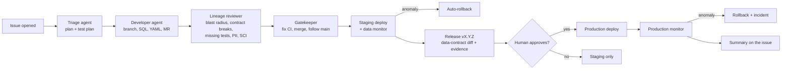

# Downstream

**The post-code lifecycle for data pipelines, run by GitLab Duo agents.**

A data team's code compiles. What breaks is everything after the commit: a renamed
column silently breaks six downstream models, nobody writes the tests, an email
column lands in a shared table, the warehouse is fully rebuilt for a one-line
change, and the dashboard goes stale until someone notices on Monday.

Downstream is a GitLab Duo Agent Platform flow plus a GitLab CI/CD pipeline that
takes an analytics change from **"someone opened an issue"** to **"it's live on the
dashboard: tested, lineage-checked, PII-safe, carbon-scored, versioned and watched"**,
with one human approval before production. It is built for analytics engineers who
run dbt projects behind business dashboards.

Built for the GitLab Transcend *Life After Code* hackathon. Path A (Start Fresh),
**Supervised** autonomy, with a generated **Hands-off** variant and an **Assisted**
review flow.

---

## What happens when someone opens an issue



One human action starts it (opening the issue) and one approves production. Every
other step is an agent or a pipeline job, and every step leaves evidence in GitLab:
a comment, a merge request note, a pipeline job, a release, an environment
deployment or an incident.

## What it catches, measured on this repo

| Failure | How Downstream catches it | Result in this repo |
| --- | --- | --- |
| A column rename that breaks downstream models | `lineage_impact.py` diffs the dbt manifest against main's, finds removed columns, and searches every child model's SQL for them | Renaming `stg_orders.amount_myr` is blocked before build, naming `fct_revenue` and `int_customer_orders` and all 4 affected dashboard tiles |
| Missing tests on new models | Key columns (`*_id`, `*_month`) without `unique`/`not_null`, and models with no YAML at all | Adding a model without YAML is blocked; while building this repo the check found a real `NULL` revenue bug in `fct_revenue` |
| Personal data leaking into a mart | `pii_sentinel.py` scans every non-raw column by name **and by sampled values** (email, phone, NRIC, Luhn-valid cards) | Catches `phone AS contact` even though the column name looks harmless |
| Silent data loss that passes every test | `monitor.py` compares the deployed release with the last known-good one | A build that loses 90% of orders passes all 44 dbt tests; the monitor fails it (3,297 → 329 rows) and the pipeline rolls back |
| Wasteful full rebuilds | Slim CI (`state:modified+` on top of main's warehouse) with an SCI score per build | A leaf-model change: **75% lower SCI** than a full refresh (measured from dbt's `run_results.json`) |

## The nine lifecycle stages

| Stage | What Downstream does | Where |
| --- | --- | --- |
| **Plan** | Triage agent turns the issue into acceptance criteria and a test plan, labels the issue | `downstream.yaml` → `triage` |
| **Create** | Developer agent writes the SQL, YAML tests and dashboard exposure, opens the MR | `downstream.yaml` → `developer` |
| **Verify** | Lineage review, slim dbt build + 44 data tests, 57 unit tests, test-gap gate | `lineage-review`, `dbt-build`, `unit-tests` jobs |
| **Secure** | SAST, secret detection, dependency scanning (SBOM), PII Sentinel | `Jobs/*` templates, `pii-sentinel` |
| **Package** | Dashboard image to the Container Registry (and Artifact Registry); tested warehouse file to the generic Package Registry | `package-image`, `package-warehouse` |
| **Release** | Semantic version from the data contract (removed contract column = major), release notes as a contract diff, evidence bundle, dbt docs on Pages | `prepare-release`, `release`, `pages` |
| **Configure** | `staging` and `production` environments on Cloud Run, one image per data release | `deploy-staging`, `deploy-production` |
| **Monitor** | Post-deploy data monitor after each deploy and hourly on a schedule; automatic rollback; incident on failure | `monitor-*`, `rollback-*`, `monitor-scheduled` |
| **Govern** | Human approval gate (Duo `HumanInputComponent` + manual `deploy-production`), `AGENTS.md` rules, evidence on every release, contract-break blocking | `production_approval`, `AGENTS.md` |

## Autonomy levels

| Level | File | What the human does |
| --- | --- | --- |
| **Supervised** (submitted) | `.gitlab/duo/flows/downstream.yaml` | Opens the issue, approves production once |
| Hands-off | `.gitlab/duo/flows/downstream-hands-off.yaml` (generated by `scripts/build_flows.py`) + CI variable `DOWNSTREAM_AUTONOMY=hands-off` | Opens the issue |
| Assisted | `.gitlab/duo/flows/downstream-review.yaml` | Writes the MR; the agent reviews and suggests, the human applies |

## How the flow drives the pipeline

Duo flow triggers only fire on human actions, so a flow cannot hand off to another
flow by merging or running a pipeline. Downstream therefore runs as **one orchestrator
flow** whose agents drive GitLab directly through `scripts/ds.py` (wait for a pipeline,
auto-merge, press the manual production job, read a job's artefacts, open an
incident). Everything deterministic (builds, scans, releases, deploys, rollbacks) is a
CI job, so it shows up in pipeline history and runs the same way with or without an agent.

Agents run one command for the whole review, `bash scripts/downstream_review.sh`,
because their `run_command` tool has no shell operators. It writes one report the
agent reads, fixes from, and re-runs.

## Sustainability: Software Carbon Intensity

Every build gets an SCI score (Green Software Foundation, ISO/IEC 21031:2024):

```
SCI = ((E × I) + M) / R        R = one data release
```

- **E** from dbt's own `run_results.json` elapsed time × vCPU power (0.71–4.26 W per vCPU) + memory (0.392 W/GB) × PUE 1.1, using [Cloud Carbon Footprint's GCP coefficients](https://www.cloudcarbonfootprint.org/docs/methodology/).
- **I** = location-based grid intensity from [Google Cloud's 2025 region data](https://cloud.google.com/sustainability/region-carbon): asia-southeast1 (Singapore) 366 gCO2e/kWh, europe-north1 (Finland) 30.
- **M** = runner embodied emissions allocated by time and vCPU share (1,200 kgCO2e per server, 4-year life, 48-vCPU host; stated assumptions).

The agent acts on it: merge requests rebuild only `state:modified+` on top of main's
warehouse, and the review compares that build's SCI with the last full refresh. For a
leaf-model change in this repo the slim build is **75% lower**; the demo change (new
model + a rename touching staging) is 14% lower because it legitimately rebuilds most
of the graph. Each report also shows a what-if row for a low-carbon region. The absolute
numbers are tiny here because the demo warehouse builds in two seconds; the ratio is
what scales to a production warehouse that rebuilds for an hour.

## Run it

**Locally** (Python 3.11+):

```bash
make install
make build      # seeds + 8 models + 44 data tests into a DuckDB file
make test       # 57 unit tests: scripts, dashboard, flow YAML, CI graph
make review     # the same review the agents run
make serve      # dashboard on http://localhost:8080
make anomaly    # watch the monitor catch a silent 90% data loss
```

**On GitLab**: see [`docs/SETUP.md`](docs/SETUP.md) to enable the flows, triggers,
CI variables and the Cloud Run deployment. Demo issues to file are in
[`demo/issues.md`](demo/issues.md).

## Repository map

```
.gitlab/duo/flows/       Supervised, Hands-off and Review flows
.gitlab/duo/agent-config.yml   runtime image + setup for the flows
.gitlab-ci.yml           build → test → package → staging → release → production → monitor
AGENTS.md                conventions and hard rules every agent follows
models/ seeds/ tests/    the dbt project (DuckDB); exposures.yml = dashboard tiles
dashboard/app.py         FastAPI dashboard (Cloud Run); /health feeds the monitor
scripts/                 lineage_impact, pii_sentinel, sci, monitor, release_notes, ds (GitLab bridge),
                         downstream_review.sh, deploy/rollback for Cloud Run, build_flows
pytests/                 unit tests
demo/                    demo issues and a verified reference solution
docs/                    setup guide, Devpost write-up, video script
```

## Honest limits

- The flows were validated against the published flow registry v1 schema and tool
  registry, and every script they call is tested here; their first live run happens
  in the hackathon's GitLab group. `docs/SETUP.md` lists what to check on that run.
- The SCI energy figure uses CCF's average coefficients, not metered power.
- Demo data is synthetic (fixed seed, fictional store and customers).

## License

MIT. See [LICENSE](LICENSE).
